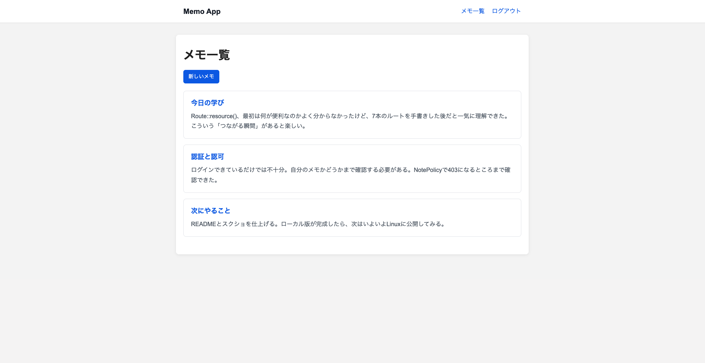
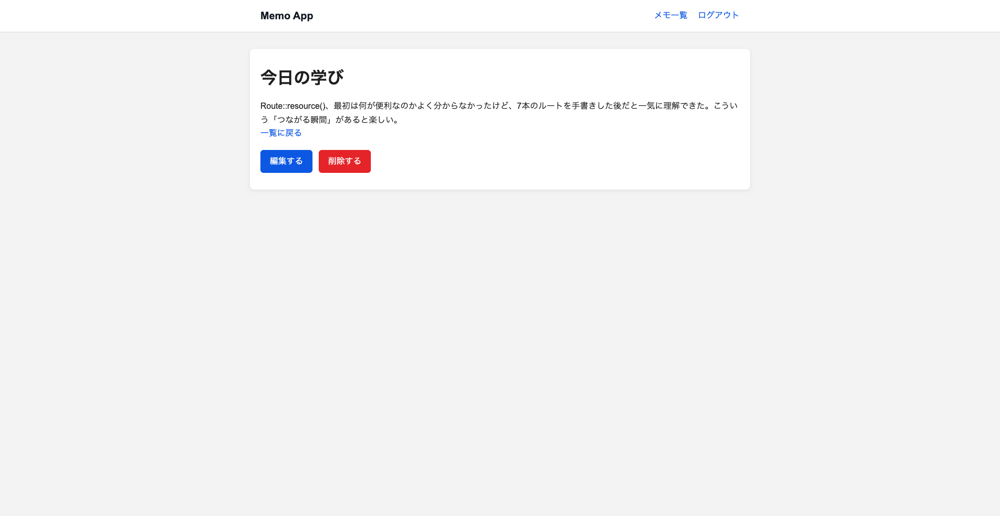
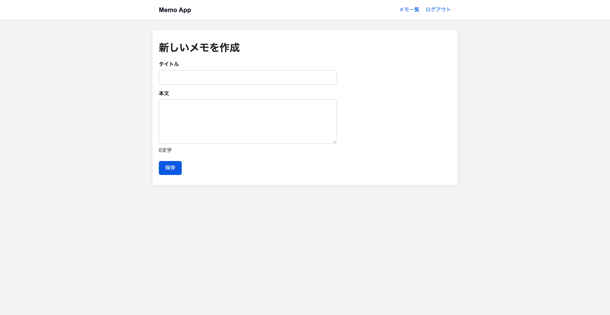

# Memo App

## 概要

Laravelの復習と、Webアプリケーションが動く仕組みを基礎から理解することを目的に作成したシンプルなメモアプリです。

ユーザー登録・ログイン後、自分のメモを作成・閲覧・編集・削除できます。

今回はアプリを動かすことだけを目的にせず、ルーティング、HTTP、データベース、認証・認可、Blade、CSS、JavaScriptなどがどのようにつながっているのかを一つずつ確認しながら実装しました。

## 主な機能

- ユーザー登録
- ログイン / ログアウト
- メモの一覧表示
- メモの新規作成
- メモの詳細表示
- メモの編集
- メモの削除
- 入力内容のバリデーション
- Policyによるメモの認可
- 削除前の確認ダイアログ
- メモ本文のリアルタイム文字数カウント

## 使用技術

- PHP
- Laravel 13
- MySQL
- Blade
- HTML
- CSS
- JavaScript
- Vite
- Git / GitHub

## データベース構成

### users

ユーザー情報を管理するテーブルです。

### notes

| カラム | 内容 |
| --- | --- |
| id | メモID |
| user_id | メモを所有するユーザーID |
| title | タイトル |
| content | 本文 |
| created_at | 作成日時 |
| updated_at | 更新日時 |

`users` と `notes` は1対多の関係になっています。

```text
User
  |
  | 1
  |
  | N
Note
```

ユーザーを削除した場合、そのユーザーが所有するメモも削除されるよう、外部キーにCascade Deleteを設定しています。

## 工夫した点・学んだこと

### CRUD・HTTPメソッド・Resource Routing

メモ機能の実装を通して、CRUD（Create / Read / Update / Delete）とHTTPメソッド、LaravelのControllerメソッドの対応を学びました。

| 操作 | HTTPメソッド | Controller |
| --- | --- | --- |
| 一覧表示 | GET | index |
| 作成画面 | GET | create |
| 新規保存 | POST | store |
| 詳細表示 | GET | show |
| 編集画面 | GET | edit |
| 更新 | PUT / PATCH | update |
| 削除 | DELETE | destroy |

最初はこれら7本のRouteを1本ずつ記述し、URL・HTTPメソッド・Controllerメソッドの関係を確認しました。

その後、LaravelのResource Routingを利用して、

```php
Route::resource('notes', NoteController::class);
```

の1行に整理しました。

最初から省略された書き方を使うのではなく、一度それぞれのRouteを実装したことで、Laravelが何を規約として自動化しているのかを理解できました。

### Named Route・Route Model Binding

BladeからURLを直接指定するのではなく、Named Routeを利用しています。

```php
route('notes.show', $note)
```

のようにRoute名を使うことで、URLの構造を変更した場合でも、View側への影響を小さくできることを学びました。

また、`/notes/{note}` のようなURLとControllerの、

```php
public function show(Note $note)
```

を組み合わせることで、LaravelがURLに含まれるIDから対応するModelを取得するRoute Model Bindingも利用しています。

```text
Model → ID → URL → ID → Model
```

という流れで、ModelとURLがどのようにつながっているのかを意識しながら実装しました。

### データベース・Eloquent・リレーション

MySQLでデータベースやユーザーを作成し、SQLの基本操作を確認したうえで、LaravelからEloquentを利用してデータを操作しました。

このアプリでは、UserとNoteを1対多の関係にしています。

```text
User 1 : N Note
```

Laravelでは、

```php
$user->notes
$note->user
```

のようにModel同士のリレーションを利用できることを学びました。

また、外部キーを設定し、ユーザーを削除した場合には、そのユーザーが所有するメモも削除されるようCascade Deleteを設定しています。

SQLやデータベースそのものと、LaravelのEloquentがどのようにつながっているのかを確認しながら実装しました。

### Controllerの役割とMVCの流れ

アプリを作る中で、Route、Controller、Model、Viewがそれぞれどのような役割を持つのかを確認しました。

基本的には、

```text
Browser
↓
Route
↓
Controller
↓
Model / Database
↓
View
↓
Response
↓
Browser
```

という流れで処理されます。

Controllerでは、Requestを受け取り、必要に応じてModelを操作し、ViewやRedirectを返しています。

単にコードを書くのではなく、「ブラウザから送られたリクエストがどこを通ってレスポンスになるのか」を意識して実装しました。

### 認証と認可

ユーザー登録・ログイン・ログアウトによる認証に加えて、メモの所有者を確認する認可も実装しました。

開発途中で、ログインしているだけではURLを直接指定することで他のユーザーのメモへアクセスできる可能性があることを確認しました。

そこで `NotePolicy` を利用し、

```php
return $user->id === $note->user_id;
```

のように、ログイン中のユーザーとメモの所有者が一致しているかを確認しています。

これにより、他のユーザーのメモを閲覧・編集・削除しようとした場合は403 Forbiddenになるようにしました。

認証は「誰なのかを確認すること」、認可は「その人がその操作をしてよいか確認すること」であり、両者は別の役割を持つことを学びました。

## ローカル環境での実行方法

### 1. リポジトリをクローン

```bash
git clone https://github.com/ginjiohashi/memo-app.git
cd memo-app
```

### 2. PHPパッケージをインストール

```bash
composer install
```

### 3. 環境設定ファイルを作成

```bash
cp .env.example .env
php artisan key:generate
```

### 4. MySQLの接続情報を設定

`.env` のデータベース設定を、自分の環境に合わせて変更します。

```env
DB_CONNECTION=mysql
DB_HOST=127.0.0.1
DB_PORT=3306
DB_DATABASE=memo_app
DB_USERNAME=your_username
DB_PASSWORD=your_password
```

### 5. Migrationを実行

```bash
php artisan migrate
```

### 6. フロントエンドのパッケージをインストール

```bash
npm install
```

### 7. 開発環境を起動

```bash
composer run dev
```

ブラウザからLaravelの開発サーバーへアクセスします。

## 今後の予定

今後、このアプリを使いながら以下についても学習・導入する予定です。

- Linuxサーバーへの公開
- Nginx
- HTTP / ポート
- DNS
- HTTPS
- Feature Test
- Docker
- GitHub Actions
- AWS

## スクリーンショット

### メモ一覧



### メモ詳細



### メモ作成

